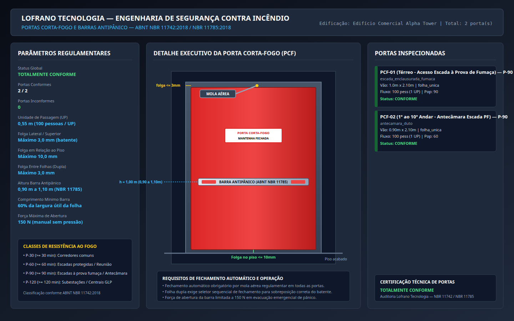
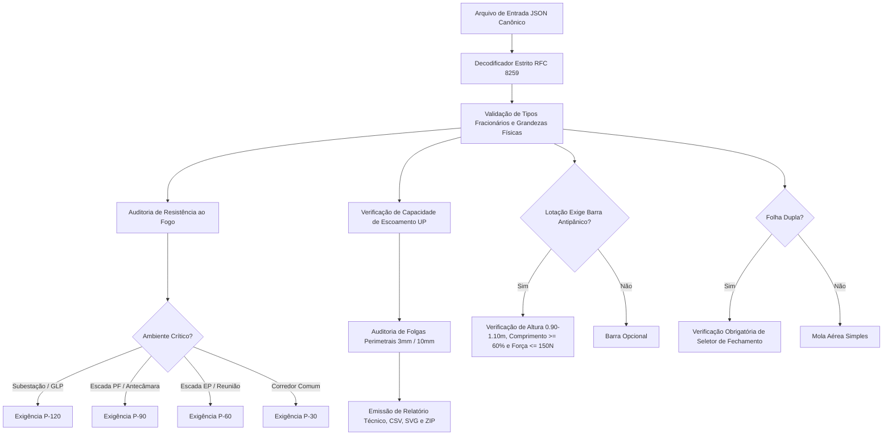

# Dimensionamento e Especificação de Portas Corta-Fogo e Barras Antipânico (ABNT NBR 11742:2018 e NBR 11785:2018)

[](https://github.com/martinlofranodeoliveira/dimensionamento-portas-corta-fogo-nbr11742/actions/workflows/ci.yml)
[](https://www.python.org/)
[](https://www.abnt.org.br/)
[-success.svg)]()
[-brightgreen.svg)]()
[](LICENSE)

Sistema computacional de alta confiabilidade para projeto, auditoria dimensional e especificação técnica de portas corta-fogo (PCF) e barras antipânico para saídas de emergência e compartimentação em edifícios, em estrita conformidade com as normas brasileiras **ABNT NBR 11742:2018** (*Porta corta-fogo para saída de emergência*), **ABNT NBR 11785:2018** (*Barra antipânico - Requisitos*) e **ABNT NBR 9077:2001** (*Saídas de emergência em edifícios*).

Desenvolvido sob as diretrizes de engenharia de software da **LOFRANO TECNOLOGIA**: 100% em português brasileiro, dependência zero de pacotes externos (utilizando exclusivamente a biblioteca padrão do Python), aritmética racional exata via `fractions.Fraction` (proibição total de ponto flutuante IEEE-754 em cálculos de folgas, vãos, capacidades e forças) e empacotamento determinístico.

---

## Painel Esquemático de Engenharia

O módulo inclui gerador vetorial SVG integrado e renderização gráfica em alta resolução (1440x900) contendo a elevação esquemática da porta corta-fogo, cotas de montagem, folgas de batente e piso, posicionamento da mola aérea regulamentar e detalhes executivos da barra antipânico:



---

## Fundamentação Normativa e Física (NBR 11742:2018 e NBR 11785:2018)

### 1. Classes de Resistência ao Fogo e Aplicações Típicas
A NBR 11742 classifica as portas corta-fogo pelo tempo mínimo em minutos durante o qual o conjunto mantém sua estabilidade mecânica, estanqueidade às chamas e isolamento térmico:

| Classe | Tempo Mínimo | Aplicações Regulamentares Típicas |
| :--- | :---: | :--- |
| **P-30** | $\ge 30\text{ min}$ | Corredores de compartimentação secundária e acessos residenciais transitórios |
| **P-60** | $\ge 60\text{ min}$ | Escadas enclausuradas protegidas (EP), halls de distribuição e locais de reunião de público |
| **P-90** | $\ge 90\text{ min}$ | Escadas à prova de fumaça (PF), antecâmaras ventiladas, dutos de pressurização e edifícios altos |
| **P-120** | $\ge 120\text{ min}$ | Subestações elétricas, salas de transformadores, grupos moto-geradores e centrais de GLP |

### 2. Vão Livre Útil e Capacidade de Escoamento
A capacidade de escoamento é calculada a partir da **Unidade de Passagem (UP)**:

$$1\text{ UP} = 0{,}55\text{ m} \quad \text{com capacidade } C = 100\text{ pessoas / UP}$$

A largura útil mínima de passagem é calculada por:

$$L_{\text{mín}} = \max\left(0{,}80\text{ m}, \left\lceil \frac{P}{100} \right\rceil \times 0{,}55\text{ m}\right)$$

> **Hospitais e Clínicas**: O vão livre deve ser de no mínimo **$2{,}20\text{ m}$** para garantir a passagem rápida e segura de macas e leitos hospitalares com equipes médicas.

### 3. Folgas Dimensionais Máximas de Montagem (Item 5.2.3 da NBR 11742)
Para conter a propagação de fumaça quente e chamas sem comprometer o fechamento automático por mola, as folgas de instalação devem satisfazer aos limites máximos:

- **Folga Superior (entre folha e batente)**: máximo de **$3{,}0\text{ mm}$**.
- **Folgas Laterais (entre folha e batente)**: máximo de **$3{,}0\text{ mm}$**.
- **Folga Inferior (entre folha e piso acabado)**: máximo de **$10{,}0\text{ mm}$**.
- **Folga Central entre Folhas (Porta Dupla)**: máximo de **$3{,}0\text{ mm}$**.

### 4. Barras Antipânico (ABNT NBR 11785:2018)
A barra antipânico é um dispositivo horizontal projetado para destravamento instantâneo sob pressão do corpo humano em fuga:

- **Obrigatoriedade**:
  - Locais de reunião de público (Grupo F) com lotação $\ge 100$ pessoas.
  - Demais ocupações quando a população servida pela porta for $\ge 200$ pessoas.
- **Altura de Instalação**: entre **$0{,}90\text{ m}$** e **$1{,}10\text{ m}$** em relação ao piso acabado (nominal $1{,}00\text{ m}$).
- **Comprimento Mínimo**: a barra móvel de acionamento deve cobrir no mínimo **$60\%$ da largura útil da folha**.
- **Força Máxima de Acionamento**: força horizontal máxima de **$150\text{ N}$** para abertura total da porta.

### 5. Dispositivos de Fechamento Automático e Coordenação
- **Mola Aérea Hidráulica**: obrigatória em todas as folhas de porta corta-fogo para garantir fechamento e travamento autônomos. A classe de força é selecionada segundo a norma EN 1154 com base na largura da folha:
  - EN 2: até $850\text{ mm}$
  - EN 3: até $950\text{ mm}$
  - EN 4: até $1100\text{ mm}$
  - EN 5: até $1250\text{ mm}$
  - EN 6: acima de $1250\text{ mm}$
- **Seletor de Fechamento (Coordenador de Sequência)**: obrigatório em portas de folha dupla com batente sobreposto, garantindo que a folha inativa feche antes da folha ativa.

---

## Fluxo Lógico e Arquitetura do Sistema



---

## Instalação e Execução

### Requisitos
- **Python 3.11 ou superior** (certificado em Python 3.11, 3.12, 3.13 e 3.14).
- Sistema operacional Linux, macOS ou Windows.
- **Zero dependências externas**: opera 100% com a biblioteca padrão (`fractions`, `json`, `csv`, `zipfile`, `os`, `sys`, `dataclasses`, `argparse`).

### Instalação
```bash
git clone https://github.com/martinlofranodeoliveira/dimensionamento-portas-corta-fogo-nbr11742.git
cd dimensionamento-portas-corta-fogo-nbr11742
python3 -m pip install .
```

---

## Interface de Linha de Comando (CLI)

O pacote disponibiliza o comando `pcf-nbr11742` (ou via módulo `python3 -m pcf_nbr11742.cli`):

```bash
# Exibir parâmetros normativos da NBR 11742 e NBR 11785
pcf-nbr11742 catalogo

# Gerar arquivo JSON modelo para preenchimento
pcf-nbr11742 gerar-exemplo --saida meu_projeto_portas.json

# Dimensionar portas gerando memorial técnico descritivo em texto
pcf-nbr11742 calcular examples/escada_enclausurada_p90.json

# Exportar resultados em JSON canônico sem ponto flutuante
pcf-nbr11742 calcular examples/escada_enclausurada_p90.json --formato json --saida relatorio.json

# Exportar resumo tabular em CSV sanitizado contra injeção de fórmulas
pcf-nbr11742 calcular examples/escada_enclausurada_p90.json --formato csv --saida resumo.csv

# Gerar painel vetorial SVG de alta resolução
pcf-nbr11742 calcular examples/escada_enclausurada_p90.json --formato svg --saida painel.svg

# Gerar pacote ZIP determinístico completo com memorial, JSON, CSV e SVG
pcf-nbr11742 calcular examples/escada_enclausurada_p90.json --pacote-zip dist/pacote_completo.zip
```

---

## Exemplo de Uso via API Python

```python
from fractions import Fraction
from pcf_nbr11742 import (
    AmbienteInstalacao,
    ClasseResistenciaFogo,
    DadosBarraAntipanico,
    DadosFolgasInstalacao,
    DadosPorta,
    DadosProjetoPortas,
    TipoFolhaPorta,
    dimensionar_projeto_portas,
    gerar_relatorio_texto,
)

# Definição das portas corta-fogo da edificação
projeto = DadosProjetoPortas(
    nome_edificacao="Edifício Corporativo Alpha",
    responsavel_tecnico="Eng. Martin Lofrano",
    portas=(
        DadosPorta(
            identificacao="PCF-ESC-01 (Térreo)",
            ambiente=AmbienteInstalacao.ESCADA_ENCLAUSURADA_FUMACA,
            tipo_folha=TipoFolhaPorta.UNICA,
            classe_especificada=ClasseResistenciaFogo.P90,
            largura_vao_livre_m=Fraction(100, 100),  # 1.00 m
            altura_vao_livre_m=Fraction(210, 100),   # 2.10 m
            populacao_atendida=80,
            dados_folgas=DadosFolgasInstalacao(
                folga_superior_mm=Fraction(25, 10),       # 2.5 mm <= 3.0 mm
                folga_lateral_esquerda_mm=Fraction(20, 10),# 2.0 mm <= 3.0 mm
                folga_lateral_direita_mm=Fraction(20, 10), # 2.0 mm <= 3.0 mm
                folga_inferior_piso_mm=Fraction(80, 10),   # 8.0 mm <= 10.0 mm
            ),
        ),
        DadosPorta(
            identificacao="PCF-SUB-01 (Subestação)",
            ambiente=AmbienteInstalacao.SUBESTACAO_SALA_ELETRICA,
            tipo_folha=TipoFolhaPorta.UNICA,
            classe_especificada=ClasseResistenciaFogo.P120,
            largura_vao_livre_m=Fraction(110, 100),
            altura_vao_livre_m=Fraction(210, 100),
            populacao_atendida=10,
        ),
    ),
)

# Execução do cálculo e auditoria normativa
resultado = dimensionar_projeto_portas(projeto)

print(f"Total de Portas: {resultado.total_portas}")
print(f"Portas Conformes: {resultado.portas_conformes}")
print(f"Sistema Conforme: {resultado.sistema_totalmente_conforme}")

# Emissão do memorial técnico
memorial = gerar_relatorio_texto(resultado)
print(memorial)
```

---

## Estrutura do Repositório

```
dimensionamento-portas-corta-fogo-nbr11742/
├── .github/workflows/ci.yml       # Multiplataforma (Linux 3.11-3.14, Windows 3.14)
├── docs/
│   ├── exemplo.png                # Renderização vetorial 1440x900 em alta resolução
│   └── painel_exemplo.svg         # SVG com elevação executiva e cotas de instalação
├── examples/
│   ├── auditorio_dupla_antipanico_p60.json
│   ├── escada_enclausurada_p90.json
│   └── subestacao_eletrica_p120.json
├── scripts/
│   ├── check_distribution.py     # Auditor estrito de pacotes sdist e wheel
│   └── generate_assets.py        # Renderizador de SVG e automação headless Chrome
├── src/
│   └── pcf_nbr11742/
│       ├── __init__.py            # Versão 1.0.0 e exports públicos
│       ├── calculator.py          # Lógica de enquadramento, folgas, barras e fluxos
│       ├── cli.py                 # Interface de linha de comando completa
│       ├── codecs.py              # Parser JSON canônico RFC 8259 sem float
│       ├── constants.py           # Constantes e coeficientes da ABNT NBR 11742 e 11785
│       ├── exporters.py           # Memorial descritivo, CSV sanitizado e ZIP determinístico
│       ├── models.py              # Dataclasses tipadas e imutáveis
│       ├── py.typed               # Marcação de tipagem estrita PEP 561
│       └── svg_generator.py       # Gerador gráfico vetorial com elevação técnica
├── tests/
│   ├── test_calculator.py         # Testes de dimensionamento, classes e molas EN
│   ├── test_casos_avancados.py    # Testes aprofundados (subestações, folgas, forças)
│   ├── test_cli.py                # Testes de execução da CLI
│   ├── test_codecs.py             # Testes de parser JSON, rejeição de floats e BOM
│   ├── test_constants.py          # Validação de coeficientes normativos
│   ├── test_exporters.py          # Testes de memorial, CSV sanitizado e ZIP
│   ├── test_models.py             # Testes de validação de dataclasses
│   └── test_svg.py                # Testes de integridade da saída gráfica vetorial
├── tools/
│   └── verify_independent.py      # Auditor independente SQLite em memória
├── LICENSE                        # Licença MIT - Lofrano Tecnologia 2026
├── pyproject.toml                 # Configuração de build determinístico PEP 621
└── README.md                      # Documentação técnica completa
```

---

## Verificação e Auditoria Independente (SQLite em Memória)

Para certificar a confiabilidade dos cálculos de maneira desacoplada do código de produção, o repositório inclui a ferramenta independente `tools/verify_independent.py`. O script utiliza um banco de dados SQLite relacional em memória com fórmulas SQL puras e aritmética de frações autônoma para auditar os cenários de teste:

```bash
python3 tools/verify_independent.py
```

---

## Padrões de Engenharia da Lofrano Tecnologia

1. **Aritmética Racional Exata**: Ausência total de tipos `float` em grandezas físicas, populacionais e ergonômicas, eliminando imprecisões de arredondamento IEEE-754.
2. **Segurança de Entrada RFC 8259**: Rejeição expressa de floats soltos no JSON, Byte Order Mark (`\xef\xbb\xbf`), chaves duplicadas e estruturas cíclicas profundas (> 32 níveis).
3. **Proteção contra Injeção de Planilhas**: Campos de texto exportados em CSV são sanitizados contra caracteres perigosos (`=`, `+`, `-`, `@`, `\t`, `\r`).
4. **Empacotamento Determinístico**: Arquivos ZIP gerados com a flag `os.O_EXCL` (prevenindo sobrescrita) e carimbo de data/hora fixo (`2026-01-01 00:00:00`).
5. **Automação Contínua (CI)**: Pipeline do GitHub Actions testado em Linux e Windows com isolamento de rede (`unshare -r -n`).

---

## Licença

Distribuído sob a licença **MIT**. Consulte o arquivo [LICENSE](LICENSE) para obter mais informações.

Copyright (c) 2026 Lofrano Tecnologia. Todos os direitos reservados.
